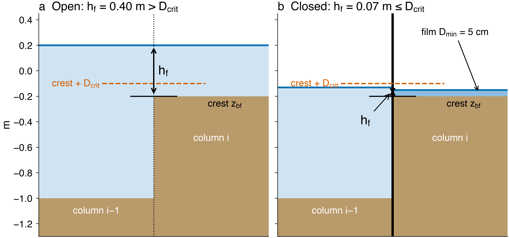

.. _sub_phys_pkg_wetdry:

WETDRY Package
--------------

.. _ssub_phys_pkg_wetdry_intro:

Introduction
++++++++++++

:filelink:`pkg/wetdry` lets water columns dry to a thin film and re-wet, so
that tidal flats, river deltas, marshes and beaches can be modeled with the
non-linear free surface (:math:`r^*` or the surface-level variant). Volume and
tracers are conserved to round-off.

Without the package, a column that empties stops the model: with
:math:`r^*`, :filelink:`calc_r_star.F <model/src/calc_r_star.F>` stops once a
column is thinner than :varlink:`hFacInf`; with the surface-level non-linear
free surface, the surface is clipped at ``Rmin_surf`` and the added volume is
only counted. Setting :varlink:`maskW` to zero alone does not close a face,
since the 2-D pressure solver, its right-hand side, continuity and the tracer
transports use :varlink:`hFacW`, not :varlink:`maskW`.

:filelink:`pkg/wetdry` therefore:

- keeps a film of depth :varlink:`wdMinDepth` in every column; dry columns
  stay in the grid (:varlink:`maskC` = 1);
- closes the faces of dry columns in both :varlink:`hFacW`/:varlink:`hFacS`
  and :varlink:`maskW`/:varlink:`maskS`;
- limits the outflow from every column so that it cannot drain below the film;
- bypasses the ``STOP`` in :filelink:`calc_r_star.F <model/src/calc_r_star.F>`.

The face mask is explicit and the free surface implicit, as in the splitting
of Casulli and Cheng (1992) :cite:`casulli:92`. The face rule follows Stelling
and Duinmeijer (2003) :cite:`stelling:03` and Casulli (2009)
:cite:`casulli:09`. For reviews of wetting-drying methods, see Balzano (1998)
:cite:`balzano:98` and Medeiros and Hagen (2013) :cite:`medeiros:13`; for
other ocean-model implementations, see Oey (2005) :cite:`oey:05` (POM) and
Warner et al. (2013) :cite:`warner:13` (ROMS).

.. _ssub_phys_pkg_wetdry_method:

Method
++++++

Definitions
###########

The water depth of a column is :math:`D = \eta_H + R_{surf} - R_{low}`, with
:math:`\eta_H` = :varlink:`etaH`, :math:`R_{surf}` = :varlink:`Ro_surf` and
:math:`R_{low}` = :varlink:`R_low`. Every column keeps
:math:`D \ge D_{min}` (= :varlink:`wdMinDepth`, 5 cm by default). A face is
open when the water over its crest is deeper than :math:`D_{crit}`
(= :varlink:`wdCritDepth`, 10 cm by default). Because
:math:`D_{crit} > D_{min}`, the shoreline has hysteresis and does not flicker
from one time step to the next.

Face rule
#########

The flow depth :math:`h_f` over a face is the higher of the two surfaces minus
the higher of the two beds (:numref:`fig_wetdry_facerule`). For the western
face of cell :math:`i`:

.. math::
   z_{bf} = \max\left( R_{low,i-1},\, R_{low,i} \right), \qquad
   h_f = \max\left( R_{surf,i-1} + \eta_{H,i-1},\;
                    R_{surf,i} + \eta_{H,i} \right) - z_{bf}

and the face mask :varlink:`wdMaskW` is 1 if :math:`h_f > D_{crit}` and 0
otherwise. Wetting needs no special case: a face opens as soon as the surface
of its neighbor rises :math:`D_{crit}` above the crest. A wet column cannot
drain below the crest plus :math:`D_{crit}` through that face.

   The face rule. (a) The flow depth :math:`h_f` over the face (higher surface
   minus higher bed, the crest :math:`z_{bf}`) is larger than
   :math:`D_{crit}`: the face is open. (b) :math:`h_f \le D_{crit}`: the face
   is closed and column :math:`i` keeps its film :math:`D_{min}`.

The closed face is removed from the geometry: :varlink:`maskW` is multiplied
by :varlink:`wdMaskW` in ``WETDRY_UPDATE_MASKS``, and :varlink:`hFacW` and
``recip_hFacW`` are multiplied by it in
:filelink:`update_r_star.F <model/src/update_r_star.F>` (or
:filelink:`update_surf_dr.F <model/src/update_surf_dr.F>` with
:varlink:`select_rStar` = 0). The mask is applied before ``UPDATE_R_STAR``, so
continuity and tracer advection see the same :varlink:`hFacW` and a uniform
tracer stays uniform. The Adams-Bashforth momentum history is set to zero on
closed faces.

Thickness of an open face
#########################

Stock :math:`r^*` builds the face thickness from the mean of the two surfaces
(the surface-level variant from the lower one). Next to a bed step, this can
be zero or negative on an open face. With :varlink:`wdUpwindFace` (default),
the surface of the upwind column is used, and every open face keeps at least
the film thickness.

Outflow (positivity) limiter
############################

After the momentum correction step, ``WETDRY_LIMIT_OUTFLOW`` compares, for
each column, the volume that leaves it in one time step with the water above
the film, :math:`(D - D_{min})\,r_A`. Every outgoing face is scaled by

.. math::
   f = \min\left(1,\; \frac{(D - D_{min})\, r_A}
                          {\Delta t \sum_{out} U\, \Delta y\, \Delta r\, h_{FacW}}\right)

Each face is outgoing for one column only, so it is scaled at most once, and
:math:`D^{n+1} \ge D_{min}` holds. Continuity and the tracer transports use
the limited velocity, so volume and tracers stay conserved. The limiter acts
as a local implicit drag. With :varlink:`useRealFreshWaterFlux`, evaporation
is limited in the same way and ramped off on dry columns (the removed part is
the diagnostic ``WDEVLIM``).

Film floor and volume budget
############################

After continuity, ``WETDRY_APPLY_FLOOR`` raises any column below the film back
to :math:`D_{min}`. With :varlink:`wdConserveVol` (default), the added volume
is taken from neighbors through open faces. With the outflow limiter this
step is a backstop that almost never acts. The global volume budget (volume
change minus inflow through open boundaries, ``addMass`` and the real
fresh-water flux, minus the floor adjustment) is printed every
:varlink:`wdMonFreq` in the ``%WETDRY_MON`` monitor lines.

Momentum in thin water
######################

- Use the vector-invariant momentum equations with
  :varlink:`upwindShear` = ``.TRUE.``; the flux form divides by
  :varlink:`hFacW` and is unstable at the drying front.
- Momentum advection is ramped off between :varlink:`wdCritDepth` and
  :varlink:`wdAdvDepth` (in :filelink:`mom_vecinv.F <pkg/mom_vecinv/mom_vecinv.F>`).
  The pressure gradient, Coriolis and bottom drag are not changed.
- Optional: a Froude-number cap :math:`|u| \le Fr_{max}\sqrt{g D}` on open
  faces (:varlink:`wdMaxFroude`), for thin sheets of water that pour off banks.
- Optional: a face that opens takes the depth-mean velocity of the upstream
  column (:varlink:`wdCarryVel`).
- Explicit quadratic bottom drag is unstable when
  :math:`C_d |u| \Delta t / h > 2`, which thin :math:`r^*` bottom cells reach:
  use :varlink:`selectImplicitDrag` = 2. An optional Manning drag,
  :math:`C_d = g n^2 D^{-1/3}` from the flow depth over each face, is set with
  :varlink:`wdManningN` or :varlink:`wdManningFile` and limited to
  :varlink:`wdDragMax`.

Tapers on shallow columns
#########################

- Surface heat, salt, short-wave and passive-tracer forcing are multiplied by
  a factor that goes from 0 at :math:`D = D_{crit}` to 1 at
  :math:`D = 2 D_{crit}` (:varlink:`wdDryForcing`, default on).
- The KPP non-local flux is capped at the surface flux in columns shallower
  than :varlink:`wdKPPCapDepth`; :varlink:`wdKPPDepth` optionally ramps it off
  (:filelink:`kpp_calc.F <pkg/kpp/kpp_calc.F>`).
- The GM/Redi tensor is ramped off below :varlink:`wdGMDepth`
  (:filelink:`gmredi_calc_tensor.F <pkg/gmredi/gmredi_calc_tensor.F>`).

Place in the time step
######################

The package routines are called from
:filelink:`forward_step.F <model/src/forward_step.F>` in this order:

::

   DYNAMICS                 u*, v*
   WETDRY_UPDATE_MASKS      face masks from etaH(n); advection ramp
   UPDATE_R_STAR            hFacW/S multiplied by wdMaskW/S
   UPDATE_CG2D, SOLVE_FOR_PRESSURE
   MOMENTUM_CORRECTION_STEP u(n+1), zero on closed faces
   WETDRY_LIMIT_OUTFLOW     Froude cap, positivity limiter
   WETDRY_CHECK_SPEED       stop on NaN or |u| > wdMaxSpeed
   INTEGR_CONTINUITY        etaH(n+1)
   WETDRY_APPLY_FLOOR       backstop film floor, budget, %WETDRY_MON
   CALC_R_STAR              no STOP when useWETDRY

.. _ssub_phys_pkg_wetdry_config:

Key subroutines and parameters
++++++++++++++++++++++++++++++

Compile-time options
####################

Add ``wetdry`` to ``packages.conf`` and ``#define NONLIN_FRSURF`` in
``CPP_OPTIONS.h``. :filelink:`WETDRY_OPTIONS.h <pkg/wetdry/WETDRY_OPTIONS.h>`
has two options, both ``#undef`` by default: ``WETDRY_DEBUG`` (extra
per-tile output) and ``WETDRY_SMOOTH_MASK`` (reserved for a smooth face mask
for the adjoint; not implemented). Manning drag needs
``#define ALLOW_BOTTOMDRAG_ROUGHNESS`` in ``MOM_COMMON_OPTIONS.h``.

Required model settings
#######################

Set :varlink:`useWETDRY` = ``.TRUE.`` in ``data.pkg``. ``WETDRY_CHECK`` stops
the model unless:

- height coordinates, :varlink:`nonlinFreeSurf` :math:`\ge` 3 (the 2-D solver
  matrix is rebuilt every time step from the current face thicknesses),
  :varlink:`select_rStar` :math:`\ge` 0 and no sigma coordinate;
- :varlink:`exactConserv` = ``.TRUE.``, :varlink:`implicitDiffusion` =
  ``.TRUE.`` and :varlink:`implicDiv2DFlow` = 1;
- :varlink:`wdCritDepth` > :varlink:`wdMinDepth` > 0;
- with :varlink:`select_rStar` = 0: :varlink:`hFacInf` :math:`\times`
  ``drF(1)`` :math:`\le` :varlink:`wdMinDepth`;
- with :varlink:`wdCarryVel` and Nr > 1: :varlink:`momImplVertAdv` =
  ``.TRUE.``;
- not used with :filelink:`pkg/seaice`, :filelink:`pkg/thsice`,
  :filelink:`pkg/salt_plume`, :varlink:`useAbsVorticity` with
  vector-invariant momentum advection, :varlink:`applyExchUV_early` or
  shelfice remeshing.

It warns about flux-form momentum, no :varlink:`upwindShear` with Nr > 1,
explicit quadratic bottom drag with Nr > 1, Adams-Bashforth stepping of
temperature, salinity or passive tracers (use a two-level advection scheme,
e.g., 33 or 77), and :filelink:`pkg/gchem` (air-sea fluxes are not ramped off
on dry columns).

A working set of ``data`` parameters for a tidal flat:

::

    nonlinFreeSurf=4, select_rStar=2, exactConserv=.TRUE.,
    implicitFreeSurface=.TRUE., hFacMin=0.01, hFacMinDr=0.01, hFacInf=0.001,
    vectorInvariantMomentum=.TRUE., upwindShear=.TRUE.,
    bottomDragQuadratic=2.5E-3, selectImplicitDrag=2,
    implicitDiffusion=.TRUE., implicitViscosity=.TRUE.,
    saltAdvScheme=33, staggerTimeStep=.TRUE.,

Run-time parameters
###################

:numref:`tab_phys_pkg_wetdry_runtime_parms` lists the parameters in
``data.wetdry`` (namelist ``WETDRY_PARM01``) and their default values.

.. tabularcolumns:: |\Y{.25}|\Y{.15}|\Y{.6}|

.. table:: WETDRY run-time parameters
   :name: tab_phys_pkg_wetdry_runtime_parms

   +--------------------------+------------------------+---------------------------------------------------------------------------+
   | Parameter                | Default                | Description                                                               |
   +==========================+========================+===========================================================================+
   | :varlink:`wdMinDepth`    | 0.05 m                 | water film kept in a dry column                                           |
   +--------------------------+------------------------+---------------------------------------------------------------------------+
   | :varlink:`wdCritDepth`   | 0.10 m                 | a face is open while the water over its crest is deeper than this         |
   +--------------------------+------------------------+---------------------------------------------------------------------------+
   | :varlink:`wdAdvDepth`    | 0.5 m                  | momentum advection ramped off below this flow depth over the face         |
   +--------------------------+------------------------+---------------------------------------------------------------------------+
   | :varlink:`wdGMDepth`     | 2 m                    | GM/Redi tensor ramped off below this column depth                         |
   +--------------------------+------------------------+---------------------------------------------------------------------------+
   | :varlink:`wdKPPCapDepth` | 20 m                   | KPP non-local flux fraction capped at 1 in shallower columns              |
   +--------------------------+------------------------+---------------------------------------------------------------------------+
   | :varlink:`wdKPPDepth`    | 0 (off)                | optional ramp of the KPP non-local flux below this column depth           |
   +--------------------------+------------------------+---------------------------------------------------------------------------+
   | :varlink:`wdDryForcing`  | ``.TRUE.``             | ramp off surface heat, salt, short-wave and tracer forcing on dry columns |
   +--------------------------+------------------------+---------------------------------------------------------------------------+
   | :varlink:`wdUpwindFace`  | ``.TRUE.``             | open-face thickness from the upwind surface                               |
   +--------------------------+------------------------+---------------------------------------------------------------------------+
   | :varlink:`wdCarryVel`    | ``.FALSE.``            | a face that opens takes the upstream depth-mean velocity                  |
   +--------------------------+------------------------+---------------------------------------------------------------------------+
   | :varlink:`wdDragDepth`   | 0 (off)                | velocity relaxation in the thinnest water (Oey 2005 :cite:`oey:05`)       |
   +--------------------------+------------------------+---------------------------------------------------------------------------+
   | :varlink:`wdManningN`    | 0 (off)                | Manning coefficient :math:`n` for :math:`C_d = g n^2 D^{-1/3}`            |
   +--------------------------+------------------------+---------------------------------------------------------------------------+
   | :varlink:`wdDragMax`     | 0.05                   | upper limit of the Manning drag coefficient                               |
   +--------------------------+------------------------+---------------------------------------------------------------------------+
   | :varlink:`wdManningFile` | :kbd:`' '`             | file with an extra 2-D Manning coefficient                                |
   +--------------------------+------------------------+---------------------------------------------------------------------------+
   | :varlink:`wdManningT1`,  | 0                      | extra coefficient: full until T1, then falls linearly to 0 at T2 (s)      |
   | :varlink:`wdManningT2`   |                        |                                                                           |
   +--------------------------+------------------------+---------------------------------------------------------------------------+
   | :varlink:`wdMaxFroude`   | 0 (off)                | cap :math:`\lvert u\rvert\le Fr_{max}\sqrt{gD}` on open faces             |
   +--------------------------+------------------------+---------------------------------------------------------------------------+
   | :varlink:`wdMaxSpeed`    | 30 m/s                 | stop, and print where, if a speed exceeds this                            |
   +--------------------------+------------------------+---------------------------------------------------------------------------+
   | :varlink:`wdConserveVol` | ``.TRUE.``             | take the volume added by the film floor from neighbors                    |
   +--------------------------+------------------------+---------------------------------------------------------------------------+
   | :varlink:`wdMonFreq`     | :varlink:`monitorFreq` | interval (s) of the ``%WETDRY_MON`` monitor output                        |
   +--------------------------+------------------------+---------------------------------------------------------------------------+
   | :varlink:`wdSmoothWidth` | 0                      | reserved (smooth mask for the adjoint); must be 0                         |
   +--------------------------+------------------------+---------------------------------------------------------------------------+

Diagnostics, monitor and pickup
+++++++++++++++++++++++++++++++

::

   ------------------------------------------------------------------------
   <-Name->|Levs|<-parsing code->|<--  Units   -->|<- Tile (max=80c)
   ------------------------------------------------------------------------
   WDEVLIM |  1 |SM      L1      |kg/m^2/s        |Evaporation removed on dry/limited columns (EmPmR)
   WDdryC  |  1 |SM      L1      |1               |wetdry dry-column flag (1=at film floor)
   WDdepth |  1 |SM      L1      |m               |Total water column depth (eta + H)
   WDmaskW |  1 |UU      L1      |1               |wetdry face mask at U point (1=open, 0=closed)
   WDmaskS |  1 |VV      L1      |1               |wetdry face mask at V point (1=open, 0=closed)

The ``%WETDRY_MON`` monitor lines give the number of dry columns, face flips,
limited columns, the minimum depth, the total volume and the volume budget
error. The pickup files ``pickup_wetdry`` and ``pickup_wetdryface`` give
bit-identical restarts.

Limitations
+++++++++++

- No adjoint: the face mask is a step function. :varlink:`wdSmoothWidth` is
  reserved for a smooth mask.
- The error against exact solutions is set by the film and the face threshold,
  not by the grid spacing.
- Opening and closing faces give step-to-step ripples within 2-3 cells of the
  shoreline; bottom drag damps them.
- The surface-level variant (:varlink:`select_rStar` = 0) only dries columns
  one level deep.
- With nothing drying, :varlink:`useWETDRY` = ``.TRUE.`` adds about 9% per time
  step (outflow limiter 3%, masks 2%) and does not lower the stable time step.
  Drying itself can lower it.
- No coupling with :filelink:`pkg/seaice` in this version.

With :filelink:`pkg/wetdry` compiled in and :varlink:`useWETDRY` =
``.FALSE.``, model results do not change.
